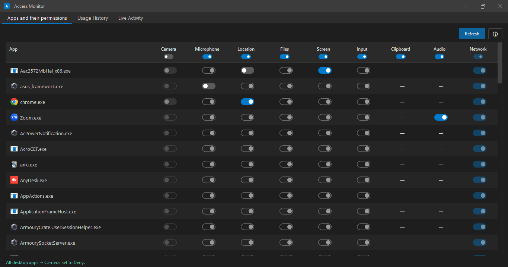
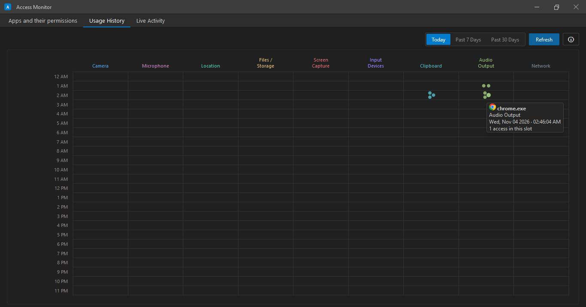
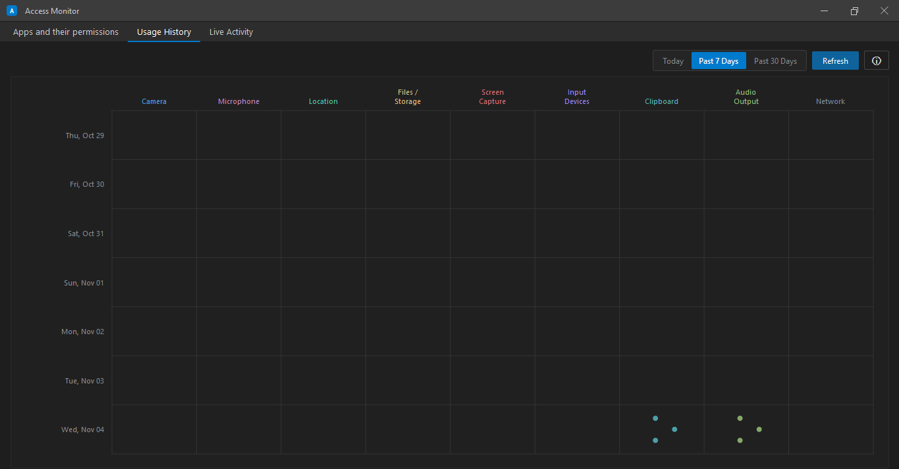
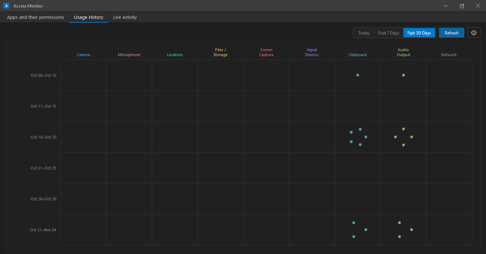
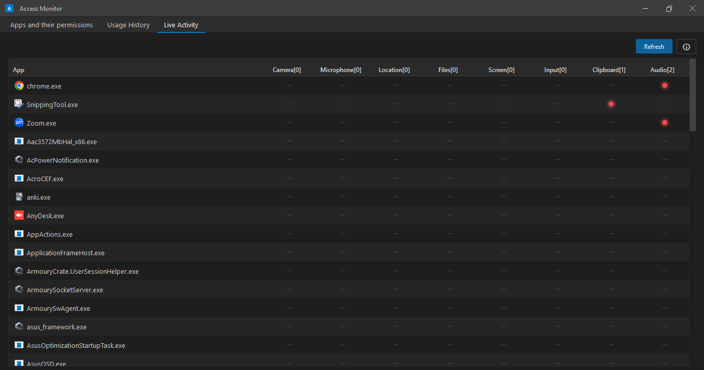

<a id="readme-top"></a>
# About The Project
Access Monitor is a lightweight Windows desktop app that shows which permissions (Camera, Microphone, Location, Files, Screen, Input) your installed apps have, and allows you to toggle them on or off. It features a live activity monitor tracking resource usage in real time, along with a 30-day interactive history chart. The app is built with a hybrid architecture: a responsive Python graphical interface backed by a high-speed C core that interacts directly with Windows registry consent stores, audio session managers, and Windows Firewall.
<p align="right">(<a href="#readme-top">back to top</a>)</p>

# Built With
- 
- 
- 
- 
<p align="right">(<a href="#readme-top">back to top</a>)</p>

# Project Overview
### Key Features
- **App Permission Matrix:** View and toggle individual app permissions for Camera, Microphone, Location, Files, Screen Capture, and Input Devices.
- **Global Master Switches:** Turn a permission on or off for all desktop applications at once with a single top-row toggle.
- **Live Activity Tracking:** Real-time dashboard showing active hardware, audio session, and clipboard usage updated every second.
- **30-Day Usage History:** Interactive grid visualizing permission access events over time, complete with detailed hover inspection.
- **Audio & Network Controls:** Mute individual app audio sessions or configure outbound firewall rules directly from the interface.

### The Three Pages
- **Apps and their permissions** — The primary management table for app permissions and system toggles.
- **Usage History** — Activity history grid filterable by Today, Past 7 Days, or Past 30 Days.
- **Live Activity** — Real-time monitor displaying active apps and hardware resource counts.

### Project Files
- `access_monitor_gui.py` — The visual window app (Python + PySide6).
- `access_monitor_core.c` — The low-level Windows API engine (C).
- `access_monitor_core.dll` — The compiled C engine file used by Python.
<p align="right">(<a href="#readme-top">back to top</a>)</p>

# How To Run The .exe File

1. Go to the `exe file` folder.
3. Open or download `AccessMonitor.exe`.
4. Double-click `AccessMonitor.exe` to run the app.

> **Note:** To toggle the **Network** switch on or off, right-click `AccessMonitor.exe` and select **"Run as administrator"**.

<p align="right">(<a href="#readme-top">back to top</a>)</p>

# How To Run from source code
This project already comes with a built `logic.dll` file, so you can run the app right away in 3 simple steps.

**Step 1. Install Python**  
Download Python from [python.org](https://www.python.org/downloads/). During setup, check **"Add python.exe to PATH"** and keep **"tcl/tk and IDLE"** checked.

**Step 2. Install PySide6**
```bash
pip install PySide6
```

**Step 3. Open CMD and run**
```bash
cd project_folder_path
python gui.py
```

---

**Step 4 (Optional). Creating The .dll File**
You only need this if you changed `logic.c` yourself.

1. Install MSYS2 from [msys2.org](https://www.msys2.org/) (or run `winget install MSYS2.MSYS2` in Command Prompt)
2. Open **MSYS2 MinGW64** from the Windows Start Menu.
3. Go to the project folder:
```bash
cd project_folder_path
```
Note: MSYS2 requires forward slashes / in paths instead of backslashes \
4. Run this command:
```bash
gcc -shared -O2 -Wall logic.c -o logic.dll -static -lsqlite3
```
<p align="right">(<a href="#readme-top">back to top</a>)</p>

# Sample Visualizations





<p align="right">(<a href="#readme-top">back to top</a>)</p>
